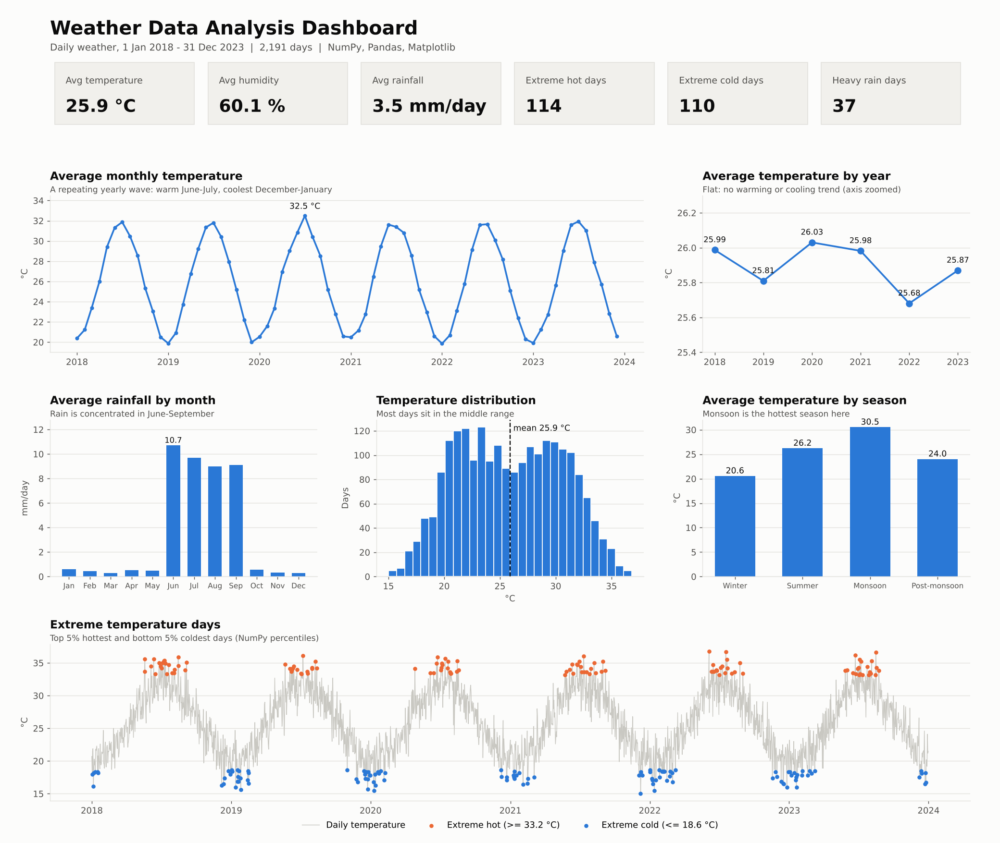

# Weather Data Analysis using NumPy, Pandas and Matplotlib

Analysis of six years of daily weather data (2018-2023) to study seasonal trends, compare months and seasons, and find extreme weather days.



## Objective
Use **Pandas** and **NumPy** for data cleaning and statistics, and **Matplotlib** for visualisation, to understand temperature, humidity and rainfall patterns.

## Dataset
File: [`data/weather.csv`](data/weather.csv)

| Column | Description |
|---|---|
| `date` | Day of the record (2018-01-01 to 2023-12-31) |
| `temperature` | Temperature in °C |
| `humidity` | Relative humidity in % |
| `precipitation` | Rainfall in mm |

- 2,191 rows (one per day), 4 columns.
- 40 missing values in each of temperature, humidity and precipitation.
- **Note:** this is a practice dataset created for learning. It follows realistic seasonal patterns, and the missing values were added on purpose to practise data cleaning. The same notebook can be run on any real weather CSV with these columns.

## Tools Used
Python, NumPy, Pandas, Matplotlib, Jupyter / Google Colab

## Project Structure
```
weather-data-analysis/
├── data/
│   └── weather.csv
├── images/
│   └── dashboard.png
├── notebooks/
│   └── Weather_Data_Analysis.ipynb
├── requirements.txt
├── .gitignore
└── README.md
```

## What the project does
1. **Load and inspect** the data with Pandas (`read_csv`, `head`, `info`, `isnull`).
2. **Clean** it: convert `date` to datetime, interpolate temperature and humidity (they change gradually), and fill missing rainfall with 0 (a missing reading most likely means no rain).
3. **Descriptive statistics** with NumPy: mean, median and standard deviation.
4. **Monthly and seasonal analysis** with `groupby` (Winter, Summer, Monsoon, Post-monsoon).
5. **Visualisations** with Matplotlib: line plots (monthly and yearly temperature), bar plot (rainfall by month), histogram (temperature distribution).
6. **Extreme weather** with NumPy percentiles: top 5% hottest days, bottom 5% coldest days, and heaviest 5% of rainy days.

## Key Findings
- Average temperature is **25.9 °C**, average humidity **60.1 %**, and average rainfall **3.5 mm/day**.
- Temperature peaks in **June-July (about 31-32 °C)** and is lowest in **December-January (about 20 °C)**.
- **Rain is concentrated in June-September** (about 9-11 mm/day) and is only about 0.3-0.6 mm/day in other months.
- Humidity is highest after the monsoon, in **October-November (about 80 %)**.
- The yearly average temperature stays between **25.68 and 26.03 °C**, so there is no clear warming or cooling trend.
- Extreme limits: hot days are at or above **33.2 °C** (114 days), cold days are at or below **18.6 °C** (110 days), and heavy rain is **37.4 mm or more** (37 days). The wettest day was **78.6 mm on 17 July 2019**.

## How to Run
**Option 1: Google Colab**
1. Open [colab.research.google.com](https://colab.research.google.com) and choose File → Upload notebook.
2. Upload `notebooks/Weather_Data_Analysis.ipynb`.
3. Upload `data/weather.csv`, then change the path in the load cell to `"weather.csv"`.
4. Run all cells.

**Option 2: Locally**
```bash
git clone https://github.com/<your-username>/weather-data-analysis.git
cd weather-data-analysis
pip install -r requirements.txt
jupyter notebook notebooks/Weather_Data_Analysis.ipynb
```

## Author
**Your Name**: add your GitHub / LinkedIn link here.
